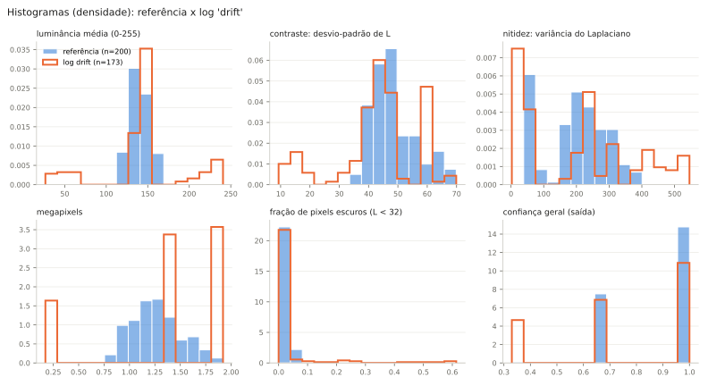

# Monitoramento do serviço de triagem de fotos de medidor

Este documento é a entrega de monitoramento. O serviço é o mesmo do [README principal](../README.md):
`POST /extrair` recebe a foto de um medidor e devolve número, função, leitura, confiança e `precisa_revisao`.

O que foi acrescentado, em uma frase cada:

- **Log em arquivo**: cada pedido ao `/extrair` vira linhas em `logs/inferencia.jsonl` (JSON Lines, append-only,
  módulo `logging` com `RotatingFileHandler`), com ~40 variáveis da foto e do resultado, inclusive nos erros 400/500.
- **`GET /metrics`**: o do BentoML (formato Prometheus) mais 4 métricas nossas; a planilha
  [`analise_metrics.xlsx`](analise_metrics.xlsx) mostra, com fórmulas, como tirar dele histograma, boxplot e taxa de erro.
- **`GET /monitor/*`**: devolve as variáveis do log prontas para histograma, boxplot, KS e PSI (JSON ou CSV).
- **Pilha Docker** ([`docker-compose.yml`](docker-compose.yml)): Prometheus (coleta e guarda o `/metrics`), Loki + Promtail
  (recebem o log) e Grafana. **DuckDB**: script que copia o `/metrics` e o log para um banco relacional.
- **Análise de drift** (KS nas variáveis contínuas, qui-quadrado/Fisher nas discretas, PSI em todas) contra um conjunto de
  referência montado à mão, com resultado real mais abaixo.
- **Modo simulado** (`BACKEND=simulado`): o mesmo serviço, sem precisar do Ollama, para gerar carga em máquina sem GPU.

## Mapa: item do enunciado → onde está

| item | pontos | onde |
|---|---|---|
| Log em arquivo texto, append-only, módulo `logging`, data/hora ISO 8601 com microssegundos e fuso | 50 | [`monitoramento.py`](../monitoramento.py) (`FormatoJsonl`, `_criar_logger`, `RastroMiddleware`), seções [Formato do log](#formato-do-log) e [Rotação](#rotação-e-append-only) |
| Variáveis de entrada e saída justificadas (CRISP-DM), suficientes para histograma, boxplot, KS e PSI | (nos 50) | [Por que estas variáveis](#por-que-estas-variáveis-crisp-dm), [Dicionário](#dicionário-de-variáveis), [Análise](#análise-ks-e-psi-os-dados-coletados-bastam) |
| Verificar se os dados bastam (recomendado) | (nos 50) | [`analise.py`](analise.py), [`drift.py`](../drift.py), resultados em [`analise/`](analise/) |
| `GET /metrics` em formato Prometheus + texto e planilha (histograma, boxplot, taxa de erro, retenção) | 10 | [Seção /metrics](#get-metrics), [`analise_metrics.xlsx`](analise_metrics.xlsx), [`planilha_metrics.py`](planilha_metrics.py), [Retenção](#por-quanto-tempo-cada-dado-fica-guardado) |
| Extra (a): log no Loki | 5 | [`docker-compose.yml`](docker-compose.yml), [`promtail/`](promtail/promtail-config.yaml), evidência [`evidencias/loki.txt`](evidencias/loki.txt) |
| Extra (b): endpoint que extrai as variáveis para histograma, boxplot, KS e PSI | 20 | [`monitor_api.py`](../monitor_api.py), seção [/monitor](#extra-b-get-monitor), evidência [`evidencias/monitor_endpoints.txt`](evidencias/monitor_endpoints.txt) |
| Extra (c): Prometheus coletando o `/metrics` | 15 | [`prometheus/`](prometheus/prometheus.yml.modelo), evidência [`evidencias/prometheus.txt`](evidencias/prometheus.txt) |
| Extra (d): `/metrics` salvo em banco Prometheus | 10 | TSDB do Prometheus em volume, retenção 15 dias/1 GB; reinício sem perda em [`evidencias/prometheus.txt`](evidencias/prometheus.txt) |
| Extra (e): `/metrics` salvo em banco relacional (DuckDB) | 5 | [`metrics_to_duckdb.py`](metrics_to_duckdb.py), [`consultas.sql`](consultas.sql), evidência [`evidencias/duckdb.txt`](evidencias/duckdb.txt) |

## Do zero ao rastro evoluindo

Precisa de: [uv](https://docs.astral.sh/uv/) (instala o Python 3.12 sozinho). `just` é opcional. Docker só para os extras.
**Não precisa de Ollama nem de GPU**: o roteiro usa o modo simulado (explicado [abaixo](#modo-simulado-e-modo-real)).
Este monitoramento está na branch `feat/monitoramento`; depois do merge, na `main`. Antes do merge, troque
o `git clone` abaixo por `git clone -b feat/monitoramento ...`.

**Porta.** Tudo usa a porta 3000. Se ela estiver ocupada, escolha outra **uma vez por terminal** com a variável
`PORTA_API`, e todas as receitas (`serve-simulado`, `carga`, `metricas`, `rastro-resumo`, `metrics-foto`, `duckdb`, `pilha`)
e o `docker compose` passam a usá-la:

| | Mac / Linux / Git Bash | Windows PowerShell |
|---|---|---|
| escolher a porta | `export PORTA_API=3001` | `$env:PORTA_API=3001` |

Sem a variável e com a porta escrita no comando, só `serve`, `serve-simulado` e `demo` aceitam a porta como argumento
(`just serve-simulado 3001`); nas outras receitas os argumentos são outra coisa (ex.: `just duckdb 30` = 30 coletas).

**Terminal 1 — sobe o serviço:**

```bash
git clone https://github.com/DaviMelooficial/triagem-fotos-medidor.git
cd triagem-fotos-medidor
uv sync                       # instala as versões travadas (inclui as bibliotecas de análise)
just serve-simulado           # ou, sem just: BACKEND=simulado uv run bentoml serve service:TriagemMedidor --port ${PORTA_API:-3000}
```

**Terminal 2 — gera carga e olha o rastro:**

```bash
just carga 100                # ou: uv run python monitoring/gerar_carga.py --n 100 --url http://localhost:${PORTA_API:-3000}
just rastro                   # ou: tail -f logs/inferencia.jsonl
```

**Windows (PowerShell), sem just** (as receitas `just` rodam em `sh`: no Windows só funcionam com o Git for Windows/Git Bash instalado):

```powershell
$env:PORTA_API=3000                                   # ou outra porta livre
$env:BACKEND="simulado"; uv run bentoml serve service:TriagemMedidor --port $env:PORTA_API     # terminal 1
uv run python monitoring/gerar_carga.py --n 100 --url "http://localhost:$env:PORTA_API"         # terminal 2
Get-Content logs\inferencia.jsonl -Wait -Tail 5                                                  # o rastro
curl.exe -s "http://localhost:$env:PORTA_API/monitor/resumo"
uv run python monitoring/analise.py
docker compose -f monitoring/docker-compose.yml up -d                                           # lê $env:PORTA_API
```

Com o `just rastro` aberto, rode `just carga 20` num terceiro terminal e veja as linhas chegando, duas por pedido
(`pedido` e `resposta`). 100 pedidos levam ~2 min (o serviço atende um por vez, ~1 s cada no modo simulado).
O que sai, medido aqui ([`evidencias/carga.txt`](evidencias/carga.txt)):

```
20:20:10 linhas no log: 1161
20:20:15 linhas no log: 1170
20:20:20 linhas no log: 1178
20:20:25 linhas no log: 1186
20:20:30 linhas no log: 1201
status HTTP: {200: 16, 400: 4}
tipos enviados: {'drift_borrada': 1, 'drift_escura': 1, 'drift_estourada': 3, 'drift_girada_90': 1, 'drift_pequena': 1, 'invalido_gif': 1, 'invalido_webp': 3, 'normal': 9}
```

Cada carga imprime um `carga_id` (ex.: `misto-483920`), que vai para o log em cada pedido e serve de filtro na análise.

**Depois da carga** (com o serviço ainda rodando; `P=${PORTA_API:-3000}`):

```bash
just metricas                 # linhas do /metrics do /extrair e as nossas; ou: curl -s localhost:$P/metrics
just rastro-resumo            # contagem por status; ou: curl -s "localhost:$P/monitor/resumo"
curl -s "localhost:$P/monitor/variaveis?formato=csv" > variaveis.csv     # tudo achatado, para planilha/pandas
just analise misto-483920     # testes de drift, PSI, histogramas e boxplots dessa carga -> monitoring/saida/
just analise                  # o mesmo para o log inteiro
```

A análise e a planilha refeitas por quem segue o roteiro vão para `monitoring/saida/` (fora do git), sem sobrescrever os
resultados desta entrega (`monitoring/analise/` e `monitoring/analise_metrics.xlsx`).

**Extras (Docker):**

```bash
just pilha                    # ou: docker compose -f monitoring/docker-compose.yml up -d   (usa PORTA_API)
just carga 100
# Prometheus: http://localhost:9090  (Status > Targets: triagem-medidor UP)
# Loki pela API: curl -s -G localhost:3100/loki/api/v1/query --data-urlencode 'query=sum by (evento,status) (count_over_time({job="triagem-medidor"}[1h]))'
# Grafana: http://localhost:3030 (sem login; Explore > Prometheus ou Loki)
just duckdb                   # 12 coletas do /metrics em 1 min + log -> monitoring/metrics.duckdb;
                              # rode junto com "just carga 50" em outro terminal, para a janela ter pedidos
just duckdb-consultas         # consultas SQL de exemplo
just pilha-parar              # derruba os containers (dados ficam nos volumes)
```

`just` lista todas as receitas. Para parar o serviço: Ctrl+C no terminal 1. No terminal do serviço, um 400 aparece numa
linha só (`Exception on /extrair [POST] (erro do cliente, 400): ...`), sem traceback: o detalhe fica no nosso log.

## Modo simulado e modo real

Na avaliação anterior o serviço foi rodado numa máquina sem GPU e cada foto passou do tempo limite. Medimos:

| máquina | o que | tempo medido |
|---|---|---|
| Mac M5 24 GB, **GPU** (Metal), modelo já carregado | `/extrair` com `N_RESPOSTAS=3` (padrão), 4 fotos de `exemplos/` | **7,6 a 9,4 s** por foto (cada chamada ao modelo 2,0 a 3,7 s) |
| idem | primeira passada, modelo frio e outra carga rodando | 19 a 25 s por foto |
| idem | `/extrair` com `N_RESPOSTAS=1` | **2,6 a 3,4 s** por foto |
| mesmo Mac **sem GPU** (`num_gpu=0`, medido em 2026-10-14) | **uma** chamada ao modelo | **194 s** (foto reduzida a 432×768) a **286 s** (900×1600) |

Saídas em [`evidencias/modo_real.txt`](evidencias/modo_real.txt). Sem GPU, `N_RESPOSTAS=3` dá 3 × 194–286 s ≈ 10–14 min
por foto, acima do timeout de 300 s; gerar 100 pedidos levaria um dia. Por isso há dois modos, escolhidos pela variável `BACKEND`:

- **`BACKEND=ollama` (padrão)**: o serviço de verdade. Sem GPU, rode com `N_RESPOSTAS=1 TIMEOUT_SEGUNDOS=900 just serve`
  (uma chamada por foto, ~3–5 min). Atenção: com N=1 não há votação, então a confiança é sempre 1,0 e só campo `null` manda
  para revisão.
- **`BACKEND=simulado`**: **modo de teste de carga**, para quem só quer ver o monitoramento funcionando. Percorre o mesmo
  caminho (abre e valida a foto, calcula as variáveis de entrada, vota, grava o log e as métricas) e só troca a chamada
  ao Ollama por [`simulado.py`](../simulado.py): uma resposta determinística derivada do sha256 da foto, com chance de erro
  que cresce quando a foto é escura, estourada, sem contraste ou borrada (como o modelo real), e latência sorteada de uma
  log-normal com mediana 0,3 × (1 + 0,1 × megapixels) s por chamada (≈0,34 s numa foto de 1,44 MP; `SIMULADO_LATENCIA_S`
  troca o 0,3). Não sobe o Ollama nem precisa dele.
  **Os números lidos são inventados**; a resposta HTTP traz `"backend": "simulado"` e **toda linha do log traz
  `backend` e `modelo`**, então nunca se confunde rastro simulado com real (o filtro `?backend=ollama` do `/monitor` separa).

## Por que estas variáveis (CRISP-DM)

**Entendimento do negócio.** O serviço faz triagem: a foto lida com segurança segue direto; a duvidosa vai para uma
pessoa. Dá errado de dois jeitos: (1) **mandar foto ruim direto** (leitura errada vira conta errada), (2) **mandar foto boa para
revisão** (custo humano, a triagem perde o sentido). E o sistema pode quebrar como software: lento, fora do ar, recusando pedido.
Por isso o monitoramento responde a três perguntas, e cada variável existe para uma delas:

1. **As fotos que chegam ainda são do tipo que o modelo lê bem?** (drift de entrada) A avaliação do README principal mostrou
   que o acerto depende da foto: resolução (fotos de campo 360×480 eram lidas muito pior que as 900×1600 da equipe), tampa suja ou
   embaçada, reflexo do sol, display apagado, foto de longe. Daí as variáveis de **tamanho** (largura, altura, megapixels, razão
   de aspecto), **brilho** (médias de L/R/G/B, fração de pixels escuros e estourados), **contraste**, **nitidez** (variância do
   Laplaciano: foto borrada tem pouca borda), **cor** (croma: P&B ou tampa amarelada), **informação** (entropia de L: tampa opaca
   é quase uniforme) e **compressão** (bytes por pixel). Se o app de campo mudar a câmera ou a resolução, ou se começar o período de
   chuva, essas distribuições mudam antes de alguém reclamar do acerto.
2. **O modelo continua decidindo do mesmo jeito?** (drift de saída) Não temos o gabarito em produção, então olhamos o que o modelo
   devolve: **confiança** por campo e geral, **fração para revisão** (é o custo da operação), **campos nulos**, **leitura com
   cara de alucinação** (000000, 0123456789: o padrão de erro que vimos na avaliação), número de dígitos lidos. Se a fração para revisão
   sobe sem a entrada mudar, o problema é o modelo (ou o prompt), não as fotos.
3. **O serviço está saudável?** **status** (ok / erro do cliente / erro do servidor), código HTTP, **tipo e mensagem do erro**,
   **latência total** e **de cada chamada ao modelo** (a diferença é fila + validação), backend, modelo e N.

**Entendimento dos dados / privacidade.** Não gravamos a foto, nem o nome do arquivo enviado (pode ter endereço ou número
do cliente), nem o número do medidor ou a leitura devolvidos (identificam o cliente). Guardamos números calculados da foto,
tamanhos (`leitura_n_digitos`) e o **sha256** dos bytes, que acha foto repetida sem guardar a foto. A `funcao` (`03`, `103`, `kWh`)
é uma categoria curta e fica. O teste `test_log_nao_guarda_nome_do_arquivo_nem_numeros_lidos` confere isso.

**Por que números por foto, e não só o histograma de pixels** (como na aula 003): o histograma de pixels somado de todas as fotos
esconde mudanças que se cancelam. No nosso teste de drift, metade das fotos ficou escura e metade estourada: a luminância
média do lote mal mexeu (140 → 143) e o KS por pixel não acusou nada (p = 0,25), mas, **por foto**, o KS acusou 12 e o PSI 13
das 13 variáveis de entrada (abaixo). Guardamos os dois: o histograma de L em 16 faixas por foto (`hist_l`) permite repetir a conta da aula.

## Formato do log

Arquivo `logs/inferencia.jsonl` (pasta muda com `LOG_DIR`), **um objeto JSON por linha** (JSON Lines). Escolhemos JSON Lines porque
cada linha é independente (dá para ler um arquivo cortado ou rotacionado), carrega tipos (número é número, `null` é `null`), aceita
blocos aninhados (`entrada`, `saida`) e é lido direto por Loki, DuckDB (`read_json_auto`), pandas (`read_json(lines=True)`) e `jq`.
CSV não aguentaria campos que só existem em parte das linhas (um 400 não tem saída) nem listas.

**Dois eventos por pedido, ligados pelo `request_id`** (que também volta ao cliente no cabeçalho `x-request-id`):

- `pedido`: gravado **antes** de chamar o modelo, com as variáveis da foto. Se o processo morrer ou o pedido estourar o tempo
  (em CPU, ~5 min por chamada), o rastro do que chegou já está no disco.
- `resposta`: gravado pelo middleware **quando a resposta HTTP termina**, para **todo** pedido ao `/extrair`, inclusive os que o
  BentoML recusa antes do nosso código (arquivo que não é imagem). Traz status, código HTTP, erro, latência total, a saída do modelo
  **e repete a entrada**. Repetir custa ~0,8 KB por pedido, mas faz cada linha `resposta` bastar sozinha: para KS/PSI basta
  filtrar `evento = resposta`, sem juntar linhas.

A hora (`ts`) vem do próprio `logging` (`record.created`), em **ISO 8601 com microssegundos e fuso horário**; `ts_epoch` é a mesma
hora em segundos desde 1970, para filtrar por janela sem converter. `versao_log` muda se o formato mudar.

Linha `resposta` **real**, tirada do log depois de `just carga` (foto superexposta: o modelo hesitou e a leitura parece alucinação, foi para revisão):

```json
{
    "ts": "2026-11-16T20:20:30.072429-03:00",
    "ts_epoch": 1794871230.072429,
    "evento": "resposta",
    "versao_log": 1,
    "request_id": "212e065f52434f94b28e4e73a3bd55f7",
    "endpoint": "/extrair",
    "backend": "simulado",
    "modelo": "simulado",
    "n_respostas": 3,
    "http_status": 200,
    "status": "ok",
    "erro_tipo": null,
    "erro_msg": null,
    "latencia_total_s": 1.2715,
    "corpo_bytes": 160879,
    "entrada": {
        "sha256": "b5251da16437dabf4609640c5d7b82afbfc613efbc00d44c11b18f8d5f97c780",
        "bytes": 160708, "formato": "JPEG", "modo_cor": "RGB", "largura": 1200, "altura": 1600,
        "megapixels": 1.92, "razao_aspecto": 0.75, "bytes_por_pixel": 0.0837, "tem_exif": false,
        "media_l": 224.173, "media_r": 226.822, "media_g": 225.336, "media_b": 211.167,
        "contraste_l": 43.933, "croma_medio": 0.0733, "nitidez_laplaciano": 545.26,
        "frac_escuros": 0.0004, "frac_estourados": 0.6707, "entropia_l": 2.242,
        "hist_l": [3e-05, 0.00036, 0.00076, 0.00153, 0.00318, 0.00745, 0.01355, 0.01911,
                   0.02623, 0.04233, 0.0515, 0.05264, 0.05425, 0.05638, 0.06871, 0.602]
    },
    "saida": {
        "precisa_revisao": true, "confianca_geral": 0.33, "confianca_numero_medidor": 0.67,
        "confianca_funcao": 1.0, "confianca_leitura": 0.33, "campos_nulos": [], "n_campos_nulos": 0,
        "respostas_identicas": false, "votos_distintos_leitura": 3, "funcao": "kvarh",
        "leitura_n_digitos": 10, "numero_medidor_n_caracteres": 10, "leitura_suspeita": true,
        "latencia_modelo_s": 1.204, "latencia_chamada_media_s": 0.401, "latencia_chamada_max_s": 0.446,
        "latencias_chamadas_s": [0.43, 0.446, 0.328]
    }
}
```

(No arquivo cada evento ocupa uma linha só; aqui foi quebrado para leitura.) Um erro 400 recusado na validação fica assim
(`entrada` e `saida` nulas porque a foto nem abriu):

```json
{"ts":"2026-11-16T20:17:00.491135-03:00","ts_epoch":1794871020.491135,"evento":"resposta","versao_log":1,"request_id":"9ca55311c82444efb0c1259029b8d747","endpoint":"/extrair","backend":"simulado","modelo":"simulado","n_respostas":3,"http_status":400,"status":"erro_cliente","erro_tipo":"validacao_upload","erro_msg":"O arquivo enviado não é uma imagem válida. Envie uma foto JPEG ou PNG.","latencia_total_s":0.0048,"corpo_bytes":35643,"entrada":null,"saida":null}
```

Uma linha do modo real (`backend: "ollama"`, `modelo: "qwen3-vl:4b"`) tem exatamente os mesmos campos; exemplos em
[`evidencias/modo_real.txt`](evidencias/modo_real.txt).

## Dicionário de variáveis

Nome como aparece no `/monitor/variaveis` (o log aninha `entrada.*` e `saida.*`). E = entrada (a foto), S = saída (o modelo),
O = operação. "Drift que detecta" diz o que uma mudança na distribuição daquela variável costuma significar.

| variável | tipo | unidade | | por que importa / drift que detecta |
|---|---|---|---|---|
| `ts`, `ts_epoch` | texto ISO 8601 / número | s | O | hora com microssegundos e fuso; janelas de tempo |
| `evento` | `pedido`/`resposta` | | O | `pedido` antes do modelo, `resposta` no fim |
| `request_id` | texto (uuid) | | O | liga `pedido` e `resposta`; volta no cabeçalho `x-request-id` |
| `backend`, `modelo`, `n_respostas` | texto, texto, inteiro | | O | separa simulado de real; troca de modelo explica mudança de saída |
| `http_status`, `status` | inteiro, `ok`/`erro_cliente`/`erro_servidor` | | O | taxa de erro; 4xx = cliente mandando lixo, 5xx = falha nossa |
| `erro_tipo`, `erro_msg` | texto | | O | por que falhou (`validacao_upload`, `InvalidArgument`, `ValidationError`...) |
| `latencia_total_s` | número | s | O | tempo do pedido inteiro, incluindo fila; histograma/boxplot de latência |
| `corpo_bytes` | inteiro | bytes | E | tamanho do corpo HTTP recebido, contado pelo middleware (vale também em upload chunked, sem `Content-Length`; existe até nos 400) |
| `carga_id` | texto ou `null` | | O | rótulo do cabeçalho `X-Carga-Id` (o gerador de carga manda); filtra uma carga sem depender de horário |
| `entrada.sha256` | texto | | E | foto repetida (reenvio do app, teste) sem guardar a foto |
| `entrada.bytes` | inteiro | bytes | E | arquivo do app mudou de compressão |
| `entrada.formato`, `entrada.modo_cor` | texto | | E | app passou a mandar PNG, HEIC, P&B |
| `entrada.largura`, `entrada.altura` | inteiro | px | E | câmera ou configuração nova |
| `entrada.megapixels` | número | MP | E | **resolução**: o fator que mais pesou no acerto da avaliação |
| `entrada.razao_aspecto` | número | largura/altura | E | foto girada ou recortada |
| `entrada.bytes_por_pixel` | número | bytes/px | E | foto lisa, borrada ou muito comprimida comprime mais |
| `entrada.tem_exif` | booleano | | E | foto vinda de outro caminho (print, edição) |
| `entrada.media_l`, `media_r`, `media_g`, `media_b` | número | 0–255 | E | foto escura (noite, sombra) ou clara (sol); dominante de cor |
| `entrada.contraste_l` | número | desvio-padrão de L | E | tampa embaçada, display apagado |
| `entrada.croma_medio` | número | 0–1 | E | P&B, tampa amarelada |
| `entrada.nitidez_laplaciano` | número | variância | E | foto tremida ou fora de foco |
| `entrada.frac_escuros`, `entrada.frac_estourados` | número | fração de pixels (L<32, L>223) | E | sombra forte; reflexo do sol na tampa |
| `entrada.entropia_l` | número | bits | E | foto sem informação (tampa opaca, chão, dedo na lente) |
| `entrada.hist_l_00` … `hist_l_15` | número | fração de pixels | E | histograma de L em 16 faixas: KS/PSI por pixel, como nas aulas 003/008 |
| `saida.confianca_geral` | 0,33 / 0,67 / 1,0 | fração de votos | S | modelo hesitando mais (com N=3) |
| `saida.confianca_numero_medidor`, `_funcao`, `_leitura` | idem | | S | qual campo piorou |
| `saida.precisa_revisao` | booleano | | S | **custo da operação**: fração que vai para uma pessoa |
| `saida.campos_nulos`, `saida.n_campos_nulos` | lista, inteiro | | S | modelo deixou de enxergar um campo |
| `saida.respostas_identicas`, `saida.votos_distintos_leitura` | booleano, inteiro | | S | concordância entre as N respostas |
| `saida.funcao` | texto curto | | S | mistura de medidores (display vs rolete) mudou |
| `saida.leitura_n_digitos`, `saida.numero_medidor_n_caracteres` | inteiro | | S | leitura com dígitos a mais/menos (juntou função e leitura) |
| `saida.leitura_suspeita` | booleano | | S | alucinação (000000, 0123456789) |
| `saida.latencia_modelo_s`, `_chamada_media_s`, `_chamada_max_s`, `latencias_chamadas_s` | número | s | O | tempo do modelo, sem fila; CPU x GPU |

Variáveis de cor e nitidez são calculadas numa cópia com no máximo 1024 px no lado maior, para fotos de tamanhos diferentes serem comparáveis.
Custo medido de abrir a foto e calcular as variáveis: mediana de 49 ms numa foto de 1,44 MP e de 66 a 98 ms numa de
1,92 MP (30 repetições; [`evidencias/custo_variaveis.txt`](evidencias/custo_variaveis.txt)).

## Rotação e append-only

- O arquivo é aberto em modo `"a"` (só acrescenta) por um `logging.handlers.RotatingFileHandler`. Quando passa de
  **10 MB** (`LOG_MAX_BYTES`), ele é renomeado para `inferencia.jsonl.1` (o `.1` vira `.2`, e assim até `.5`) e um arquivo novo
  começa. Ficam **5 backups** (`LOG_BACKUPS`): no máximo ~60 MB.
- Medido no log desta entrega ([`evidencias/tamanho_log.txt`](evidencias/tamanho_log.txt)): `pedido` ≈ 0,8 KB, `resposta` ≈ 1,4 KB,
  ~2,2 KB por pedido → **~4.700 pedidos por arquivo, ~28 mil no total**. Em volume de campo (dezenas de milhares de fotos por dia) isso cobre menos de um dia: em produção o arquivo
  é a fonte, e o histórico longo fica no Loki (abaixo) ou em armazenamento próprio.
- Logger dedicado (`triagem.rastro`) que **não propaga** para o log do BentoML no terminal.
- **1 processo** (`workers=1` no `@bentoml.service`): o `RotatingFileHandler` não é seguro com vários processos escrevendo no mesmo arquivo.
- `/monitor/variaveis` e `analise.py` leem o atual **e** os rotacionados, do mais antigo para o mais novo.
- O teste `test_log_e_append_only` força a rotação (arquivos de 6 KB) e confere que o conteúdo antigo nunca muda, só cresce.

## Análise KS e PSI: os dados coletados bastam?

**Conjunto de referência, montado à mão** ([`referencia.py`](referencia.py) → [`referencia.json`](referencia.json)): as 4 fotos
de `exemplos/` com 50 variações **leves** cada (brilho e contraste ±10 %, giro até 3°, recorte até 8 %, escala 80–100 %, JPEG 80–95),
seed fixa: 200 amostras de "foto de campo aceitável". As variáveis de entrada são calculadas pela mesma função do serviço;
as de saída vêm do backend simulado. Só números são salvos.

**Teste certo para cada tipo de variável** ([`drift.py`](../drift.py)):

- as 13 variáveis **contínuas** da foto: **KS** de duas amostras;
- as 11 **discretas ou categóricas** da saída (confiança 0,33/0,67/1,0, `precisa_revisao`, nulos, função lida, nº de dígitos...):
  **qui-quadrado de homogeneidade** na tabela referência × lote, **Fisher** quando alguma contagem esperada é < 5. O KS em variável
  com 2 ou 3 valores é conservador demais (cheio de empates): na primeira versão ele dava p = 0,006 para `precisa_revisao` subir de
  34 % para 51 %, o que não passa na correção de Bonferroni; o qui-quadrado dá p = 0,00097;
- em todas, **PSI** (decis da referência nas contínuas, as próprias categorias nas discretas);
- **25 testes** ao todo (24 variáveis + o KS por pixel da aula 003): a correção de Bonferroni exige p < 0,05/25 = 0,002;
- para o KPI `precisa_revisao`, também a **diferença em pontos percentuais com IC 95 %**.

**Experimento**: duas cargas de 200 pedidos, cada uma marcada com um `carga_id` que entra no log
([`evidencias/carga.txt`](evidencias/carga.txt)): `normal-7` (mesmas variações leves da referência: não devia acusar nada) e
`drift-8` (fotos escuras, estouradas, borradas, P&B, pequenas 360×480 e giradas 90°: devia acusar). Nos dois, 10 % de arquivos
inválidos (dão 400 e não entram nos testes). Rodado com
`uv run python monitoring/analise.py normal-7 --rotulo normal --saida monitoring/analise` (idem `drift-8`); o mesmo resultado sai
de `GET /monitor/drift?carga_id=drift-8` ([`evidencias/monitor_endpoints.txt`](evidencias/monitor_endpoints.txt)).

| variável | teste | carga normal: estatística (p) | PSI | carga drift: estatística (p) | PSI |
|---|---|---|---|---|---|
| megapixels | KS | 0,083 (0,53) | 0,17 | **0,599 (1,5e-31)** | **3,26** |
| razão de aspecto | KS | 0,062 (0,85) | 0,10 | **0,450 (1,8e-17)** | **2,70** |
| luminância média | KS | 0,046 (0,98) | 0,06 | **0,256 (7,3e-06)** | **1,60** |
| contraste | KS | 0,149 (0,030) | 0,12 | **0,254 (9,5e-06)** | **0,99** |
| nitidez (Laplaciano) | KS | 0,096 (0,34) | 0,10 | **0,301 (5,9e-08)** | **1,20** |
| fração estourada | KS | 0,100 (0,30) | 0,11 | **0,239 (3,7e-05)** | **1,78** |
| entropia | KS | 0,087 (0,46) | 0,06 | **0,365 (1,6e-11)** | **1,67** |
| confiança geral (saída) | qui²/Fisher | Fisher (0,13) | 0,04 | **qui² (3,3e-10)** | **0,73** |
| `precisa_revisao` (saída) | qui² | qui² (0,095) | 0,04 | **qui² (9,7e-04)** | 0,12 |
| função lida (saída) | qui²/Fisher | qui² (0,81) | 0,02 | Fisher (0,49) | 0,05 |

Em negrito, o que passa na correção de Bonferroni (p < 0,002) ou no critério do PSI. `precisa_revisao`: **34,0 % → 25,4 %**
na carga normal (−8,6 pp, IC 95 % [−17,8; +0,7]: o intervalo contém 0, não é mudança) e **34,0 % → 51,4 %** na carga drift
(**+17,4 pp, IC 95 % [+7,5; +27,4]**). Tabelas completas (24 variáveis) em [`analise/normal_ks_psi.txt`](analise/normal_ks_psi.txt) e
[`analise/drift_ks_psi.txt`](analise/drift_ks_psi.txt); gráficos:
[histogramas normal](analise/normal_histogramas.svg), [histogramas drift](analise/drift_histogramas.svg),
[boxplots normal](analise/normal_boxplots.svg), [boxplots drift](analise/drift_boxplots.svg),
[latência](analise/drift_latencia.svg).



O que isso mostra:

- **Os dados bastam para separar os dois casos.** Na carga drift, 19 das 24 variáveis acusam depois de Bonferroni (12 das 13 de
  entrada e 7 das 11 de saída) e 17 no PSI; na carga normal, nenhuma depois da correção e nenhuma no PSI. A fração para revisão
  subiu 17 pontos: o drift de entrada virou custo de operação. A função lida não mudou (o simulador sorteia a função pelo
  sha256 da foto, independente da qualidade), e é isso que o teste diz.
- **Média parecida não quer dizer distribuição parecida.** Na carga drift a luminância média foi de 140 para 143 e a nitidez
  de 198 para 202, porque fotos escuras e estouradas (e borradas e pequenas) se compensam. Os testes olham a forma da
  distribuição e acusam. Um alerta só na média não pegaria. O KS por pixel (histograma de L somado) também não pegou (p = 0,25).
- **Alarme falso tem taxa medida.** Na carga normal o contraste deu p = 0,030: com 25 testes a 5 %, alarme falso é o esperado.
  Medimos sem drift nenhum ([`alarme_falso.py`](alarme_falso.py), 1.000 rodadas sorteando referência e lote do mesmo conjunto,
  [`evidencias/alarme_falso.txt`](evidencias/alarme_falso.txt)): **44 % das rodadas têm ao menos um p < 0,05; 2,5 % depois de
  Bonferroni; 6,3 % com ao menos um PSI acusando**. O PSI **não tem correção de multiplicidade** (o limite de ruído é de 95 % por
  variável), então ~6 % das janelas sem drift terão um alarme de PSI em alguma variável; por isso o contrato abaixo pede
  3 variáveis e Bonferroni, não um PSI isolado.
- **Quantas amostras precisa.** Com 200 de referência e ~170 no lote, o KS só dá p < 0,05 se a distância D passar de **0,14**, e
  passa no Bonferroni só acima de **0,19** (valores críticos impressos no topo da análise; não são o poder do teste, que depende do
  tamanho da mudança). O PSI tem um piso de ruído: **sem drift nenhum** ele vale em média (faixas − 1) × (1/n_ref + 1/n_lote). Com 10
  faixas e 60 × 55 amostras isso dá ~0,31, acima do limiar usual de 0,25: com amostra pequena o PSI acusa drift que não existe
  (aconteceu nos nossos primeiros testes). Por isso a referência tem 200, o código calcula o limite de ruído (95 %, aproximação
  qui-quadrado) e só marca `psi_drift` quando o PSI passa de 0,25 **e** desse limite. Regra prática: lote ≥ 150–200 fotos por janela.
- **Limites desta referência** (honestos):
  - a saída é do modo simulado, inventada: o drift de saída aqui prova que a coleta e a comparação funcionam, não diz nada do
    modelo real. Por isso o `/monitor/drift` compara só respostas do mesmo backend da referência;
  - as 200 amostras **não são independentes**: são 4 fotos × 50 variações. O tamanho efetivo é menor que 200, os p-valores ficam
    otimistas, e "a carga normal não acusa" é quase por construção (ela usa as mesmas 4 fotos e as mesmas variações);
  - as fotos da equipe têm 900×1600 e 1200×1600; as de campo citadas no README principal têm 360×480. Contra esta referência,
    fotos de campo reais **sempre** acusariam drift em megapixels, razão de aspecto e bytes por pixel;
  - **em produção** a referência deve ser uma amostra real e grande (centenas a milhares de fotos de campo) do período em que o
    modelo foi avaliado e aceito, com a saída do modelo real e, idealmente, já revisada por pessoas. `just referencia` mostra
    como gerar o arquivo; trocar a fonte das fotos é trocar `variacoes.fotos_base()`.

## GET /metrics

`curl -s localhost:3000/metrics` devolve texto no **formato de exposição do Prometheus**. É o endpoint do próprio BentoML
(liga sozinho); acrescentamos 4 métricas com `prometheus_client`. As que importam aqui:

| métrica | tipo | rótulos | o que é |
|---|---|---|---|
| `bentoml_service_request_duration_seconds` | histograma (`_bucket`, `_sum`, `_count`) | `endpoint`, `http_response_code`, `le` | duração de cada pedido HTTP |
| `bentoml_service_request_total` | contador | `endpoint`, `http_response_code` | pedidos por endpoint e código |
| `bentoml_service_request_in_progress` | gauge | `endpoint` | pedidos em andamento agora |
| `triagem_predicoes_total` | contador | `backend`, `status`, `precisa_revisao` | resultado de cada `/extrair` |
| `triagem_confianca_geral` | histograma | `backend` | confiança geral das respostas 200 |
| `triagem_latencia_chamada_modelo_segundos` | histograma | `backend` | cada chamada ao modelo (N por pedido) |
| `triagem_entrada_luminancia_media` | histograma | | luminância das fotos: um sinal de drift já no Prometheus |

Trecho real ([`evidencias/metrics_depois.txt`](evidencias/metrics_depois.txt), depois de 100 pedidos):

```
bentoml_service_request_duration_seconds_bucket{endpoint="/extrair",http_response_code="200",le="1.0",...} 1.0
bentoml_service_request_duration_seconds_bucket{endpoint="/extrair",http_response_code="200",le="2.5",...} 65.0
bentoml_service_request_duration_seconds_bucket{endpoint="/extrair",http_response_code="200",le="5.0",...} 95.0
bentoml_service_request_duration_seconds_count{endpoint="/extrair",http_response_code="200",...} 95.0
bentoml_service_request_duration_seconds_bucket{endpoint="/extrair",http_response_code="400",le="0.05",...} 2.0
bentoml_service_request_total{endpoint="/extrair",http_response_code="200",...} 95.0
bentoml_service_request_total{endpoint="/extrair",http_response_code="400",...} 5.0
```

Mudamos só as faixas (`buckets`) do histograma de latência: as padrão do BentoML vão até 180 s; acrescentamos **300 e 600 s**
porque um pedido em CPU passa disso (os nomes das métricas não mudam).

### Como analisar (e a planilha)

[`analise_metrics.xlsx`](analise_metrics.xlsx) foi gerada com [`planilha_metrics.py`](planilha_metrics.py) a partir de duas
fotos reais do `/metrics`, uma **antes** e outra **depois** de uma carga de 100 pedidos
([`metrics_antes.txt`](evidencias/metrics_antes.txt), [`metrics_depois.txt`](evidencias/metrics_depois.txt)), com o comando
`uv run python monitoring/planilha_metrics.py --antes ... --depois ... --saida monitoring/analise_metrics.xlsx --recalcular`.
As células amarelas são **fórmulas**: cole outra foto nas colunas ANTES/DEPOIS (contagens dos buckets, `_sum` da latência,
`request_total`) e tudo se recalcula. A aba `erros` tem linhas fixas para 200, 400 e 500 do `/extrair`; para um código novo, insira
uma linha dentro da tabela. O arquivo versionado já traz os valores calculados (gravados com o LibreOffice pelo `--recalcular`);
uma planilha refeita sem LibreOffice é calculada ao abrir no Excel, LibreOffice ou Google Planilhas. Para refazer com os seus
números (vai para `monitoring/saida/analise_metrics.xlsx`, sem tocar na da entrega):

```bash
just metrics-foto antes.txt      # ou: uv run python monitoring/planilha_metrics.py --foto antes.txt --url http://localhost:3000
just carga 50
just metrics-foto depois.txt
just planilha antes.txt depois.txt   # ou: uv run python monitoring/planilha_metrics.py --antes antes.txt --depois depois.txt
```

O passo a passo do que a planilha calcula:

1. **Por que duas fotos.** O `/metrics` só tem contadores **acumulados desde que o processo subiu**. Não há "últimos 5 minutos".
   O que aconteceu entre dois instantes é `depois − antes` (é o que `increase()` faz no Prometheus).
2. **Histograma da latência.** Cada `_bucket{le="X"}` conta os pedidos com duração **≤ X** (cumulativo). Pedidos na faixa
   (X_anterior, X] = `bucket[X] − bucket[X_anterior]`. Na janela medida (somando os códigos 200 e 400): 2 pedidos em 0–0,05 s
   (400 recusados sem esperar fila), 2 em 0,5–1 s, **66 em 1–2,5 s**, **30 em 2,5–5 s**. A aba `latencia` faz o gráfico de barras com essas contagens.
3. **Quantis e boxplot.** Para o quantil q: posição = q × total; acha-se o primeiro bucket cujo cumulativo alcança a posição e
   interpola-se linearmente dentro dele: `inferior + (superior − inferior) × (posição − cumulativo_anterior) / pedidos_no_bucket`.
   É a mesma conta do `histogram_quantile` do Prometheus (conferimos: mesmos valores calculados em Python). Resultado: Q1 = 1,48 s,
   mediana = 2,05 s, Q3 = 2,92 s, p95 = 4,58 s; mínimo e máximo só se sabem até a faixa (0 e 5 s). Com esses cinco números a
   planilha desenha o boxplot (barras empilhadas com a base invisível).
   **É estimativa**: a mediana real, tirada do log na mesma janela (n = 100), foi 2,30 s e o p95 real 2,99 s
   ([`evidencias/quantis_reais_log.txt`](evidencias/quantis_reais_log.txt)). O erro pode chegar à largura da faixa
   (2,5–5 s). Para latência exata, o log (`latencia_total_s`) ou o `/monitor/resumo`.
4. **Média.** `_sum / _count` = 223,54 s / 100 = 2,24 s (o `_sum` está em [`metrics_depois.txt`](evidencias/metrics_depois.txt);
   na foto ANTES o serviço ainda não tinha pedido ao `/extrair`, então vale 0).
5. **Taxa de erro.** Aba `erros`: soma dos `request_total` do `/extrair` com código ≥ 400 ÷ total do `/extrair` na janela =
   5 / 100 = **5 %** (todos 4xx, culpa de quem enviou; 5xx = 0). Separar 4xx de 5xx importa: 4xx alto é o app mandando arquivo
   ruim; 5xx alto é o nosso serviço.
6. **No Prometheus** (aba `promql`), com janela deslizante e sem precisar de duas fotos:

```promql
sum by (le) (increase(bentoml_service_request_duration_seconds_bucket{endpoint="/extrair"}[5m]))   # histograma
histogram_quantile(0.95, sum by (le) (rate(bentoml_service_request_duration_seconds_bucket{endpoint="/extrair"}[5m])))  # p95 (0.25/0.5/0.75 para o boxplot)
sum(rate(bentoml_service_request_total{endpoint="/extrair",http_response_code=~"[45].."}[5m]))
  / sum(rate(bentoml_service_request_total{endpoint="/extrair"}[5m]))                                # taxa de erro
```

Essas contas já ficam gravadas como séries pelas regras em [`prometheus/regras.yml`](prometheus/regras.yml)
(`triagem:taxa_erro:5m`, `triagem:latencia_p50:5m`, `triagem:latencia_p95:5m`, `triagem:fracao_revisao:5m`), com dois alertas.

### Por quanto tempo cada dado fica guardado

| onde | o que guarda | por quanto tempo |
|---|---|---|
| `GET /metrics` do serviço | só o **acumulado** desde que o processo subiu, em memória (arquivos de trabalho em `$BENTOML_HOME/prometheus_multiproc_dir`) | **até o processo reiniciar**: zera ao parar o serviço. Não há histórico nem janela de tempo. |
| Prometheus (extras c/d) | uma amostra de cada série a cada **5 s**, no TSDB (volume Docker `prometheus-dados`) | **15 dias ou 1 GB**, o que vier primeiro (`--storage.tsdb.retention.time=15d`, `--storage.tsdb.retention.size=1GB`; padrão do Prometheus: 15 d sem limite de tamanho). Sobrevive a reiniciar o container. |
| `logs/inferencia.jsonl` | cada pedido, com todas as variáveis | até **10 MB × (1 + 5 backups) ≈ 60 MB ≈ 28 mil pedidos**; o mais velho é apagado na rotação |
| Loki (extra a) | as linhas do log | **7 dias** (`retention_period: 168h`, compactor ligado), volume `loki-dados` |
| DuckDB (extra e) | cada coleta do `/metrics` + o log | **sem limite**: arquivo `monitoring/metrics.duckdb` cresce (~1 MB para 31 coletas = 2.876 linhas, com 32 séries por coleta antes do primeiro pedido e 97 depois, + 1.161 eventos) até alguém apagar |

**Armadilha que encontramos**: cada `bentoml serve` **apaga** `$BENTOML_HOME/prometheus_multiproc_dir` ao subir. Subir um segundo
serviço na mesma máquina (ou rodar o `pytest`, que sobe o seu) zerava o `/metrics` do primeiro. Os testes agora usam um `BENTOML_HOME`
próprio; se precisar de dois serviços, dê a cada um o seu (`BENTOML_HOME=/tmp/outro just serve-simulado 3001`).

## Extra (b): GET /monitor/*

App Starlette ([`monitor_api.py`](../monitor_api.py)) montado no serviço com `@bentoml.asgi_app(app, path="/monitor")`
(o `@bentoml.api` só cria POST). Lê o log, **inclusive os arquivos rotacionados**.

| rota | devolve |
|---|---|
| `GET /monitor/variaveis` | uma linha por evento, achatada (`entrada.media_l`, `saida.confianca_geral`, `entrada.hist_l_00`...), em JSON ou `formato=csv` |
| `GET /monitor/resumo` | por variável numérica: n, mín, Q1, mediana, Q3, p95, máx, média (boxplot) e contagens por faixa (histograma, `faixas=10`) |
| `GET /monitor/drift` | teste de drift de cada variável contra `referencia.json` (KS nas contínuas, qui-quadrado/Fisher nas discretas), p-valor, PSI com limite de ruído, listas com/sem Bonferroni e, para `precisa_revisao`, a diferença em pontos percentuais com IC 95 % |
| `GET /monitor/referencia` | os valores da referência, para quem quiser fazer a própria conta |

Filtros (todos opcionais): `inicio`, `fim` (ISO 8601; sem fuso = hora local), `evento` (`resposta` padrão, `pedido`, `todos`),
`status` (`ok`, `erro_cliente`, `erro_servidor`), `backend` (`simulado`, `ollama`), `carga_id`, `limite` (últimas N linhas);
no `/resumo`, `faixas` (1 a 1000); no `/drift`, `alfa` (entre 0 e 1). Parâmetro inválido = 400.

O `/monitor/drift` compara **só respostas do backend da referência** (`simulado`, porque a referência foi gerada com ele):
misturar respostas do modelo real com uma referência simulada acusaria "drift" que é só troca de backend. `?backend=ollama`
compara as do modelo real mesmo assim, de propósito; o campo `backend_lote` da resposta diz o que foi comparado.

```bash
curl -s "localhost:3000/monitor/variaveis?formato=csv&inicio=2026-11-16T20:00" > variaveis.csv
curl -s "localhost:3000/monitor/variaveis?status=erro_cliente&limite=5"
curl -s "localhost:3000/monitor/drift?carga_id=drift-8"          # compara uma carga com a referência
curl -s "localhost:3000/monitor/drift?backend=ollama"            # força comparar respostas do modelo real (ver abaixo)
```

Saídas reais em [`evidencias/monitor_endpoints.txt`](evidencias/monitor_endpoints.txt). No Swagger (<http://localhost:3000>) só
aparece o `/extrair`; as rotas `/monitor/*` são do app montado.

## Extras (c) e (d): Prometheus coletando e guardando o /metrics

[`prometheus/prometheus.yml.modelo`](prometheus/prometheus.yml.modelo): coleta `host.docker.internal:3000/metrics` a cada 5 s (o
serviço roda fora do Docker; no Linux o compose mapeia `host.docker.internal` para o host). A porta vem de `PORTA_API`
(o compose troca no arquivo antes de subir). O banco é o próprio TSDB do Prometheus, num volume Docker, com retenção explícita.
Evidência ([`evidencias/prometheus.txt`](evidencias/prometheus.txt), serviço na porta 3300 nesta máquina):

```
triagem-medidor http://host.docker.internal:3300/metrics health=up lastScrape=2026-11-16T23:19:22Z erro=''
{'storage.tsdb.retention.time': '15d', 'storage.tsdb.retention.size': '1GiB', 'storage.tsdb.path': '/prometheus'}
histogram_quantile(0.95, ...[10m])  -> 4.5957
taxa de erro [10m]                  -> 0.0309
count_over_time(bentoml_service_request_total{endpoint="/extrair",http_response_code="200"}[1h])
  antes de reiniciar: 105    depois de 'docker compose restart prometheus': 105
recording triagem:taxa_erro:5m ok / triagem:latencia_p95:5m ok / ... ; alerting TriagemTaxaErroAlta ok inactive
```

O `increase()` na mesma janela deu 96,4 pedidos 200 e 3,1 pedidos 400, e não 95 e 5: o Prometheus extrapola até as bordas da
janela e a série do código 400 só passou a existir no primeiro 400 (ele não supõe que valia 0 antes). A contagem exata da janela
está na planilha e no DuckDB. Consequência para o alerta: **o primeiro erro de um código novo não entra no `increase()`/`rate()`**,
nem em `triagem:taxa_erro:5m`; só os seguintes. Aqui isso afeta o 400 (e qualquer outro código novo), mas não o 500: o BentoML
já cria a série do 500 com valor 0 antes do primeiro pedido (está em [`metrics_antes.txt`](evidencias/metrics_antes.txt)), então
o primeiro 500 já conta. O log e o Loki registram todos.

## Extra (a): log no Loki

Promtail ([`promtail/promtail-config.yaml`](promtail/promtail-config.yaml)) lê `logs/inferencia.jsonl` (pasta montada só leitura),
usa o `ts` da linha como hora do evento e cria rótulos só com campos de poucos valores (`evento`, `status`, `backend`); o resto
fica no JSON e é lido na consulta com `| json`. Evidência ([`evidencias/loki.txt`](evidencias/loki.txt)):

```
$ LogQL: sum by (evento, status) (count_over_time({job="triagem-medidor"}[1h]))
{'evento': 'pedido'} 561
{'evento': 'resposta', 'status': 'erro_cliente'} 72
{'evento': 'resposta', 'status': 'ok'} 528            -> 1.161 = número de linhas do arquivo
$ LogQL: {job="triagem-medidor", status="erro_cliente"} | json | line_format "{{.ts}} {{.http_status}} {{.erro_tipo}} {{.erro_msg}}"
2026-11-16T20:16:49.735861-03:00 400 InvalidArgument Formato WEBP não aceito. Envie uma foto JPEG ou PNG.
$ LogQL: quantile_over_time(0.95, {...evento="resposta", status="ok"} | json latencia_total_s="latencia_total_s" | unwrap latencia_total_s [1h]) by (backend)
{'backend': 'simulado'} 3.102525
```

O p95 de 3,10 s pelo Loki bate com o calculado no DuckDB sobre o mesmo log (3,103 s).

## Extra (e): /metrics em banco relacional (DuckDB)

[`metrics_to_duckdb.py`](metrics_to_duckdb.py) lê o `/metrics` a cada N segundos e grava cada série numa linha da tabela
`metricas` (hora da coleta, nome, `endpoint`, `http_code`, `le`, rótulos em JSON, valor). Com `--log` carrega também o log na tabela
`eventos`. Guardar coletas periódicas é o que dá janela de tempo a um `/metrics` que só tem acumulado.
Exemplos em [`consultas.sql`](consultas.sql) (`just duckdb-consultas`); saída real ([`evidencias/duckdb.txt`](evidencias/duckdb.txt)):

```
-- 1) Pedidos ao /extrair por código HTTP entre a primeira e a última coleta
│ 200       │    95.0 │   0.95 │
│ 400       │     5.0 │   0.05 │
-- 3) Direto do log (tabela eventos): latência e revisão por backend, só respostas 200
│ simulado │   528 │         2.364 │     3.103 │          0.366 │
```

## Contrato de monitoramento (sinal, limiar, ação, dono)

| fim | sinal (fonte) | limiar | ação | dono |
|---|---|---|---|---|
| saúde | `triagem:taxa_erro:5m` e `triagem:latencia_p95:5m` (Prometheus; alertas em `regras.yml`) | erro > 20 % por 2 min; p95 > 30 s por 2 min | 5xx: ver `erro_tipo` no Loki e o Ollama; 4xx: avisar o time do app; p95: ver se está sem GPU ou com fila | quem opera o serviço |
| drift de entrada | teste e PSI por foto (`/monitor/drift`, janela de ≥ 150 fotos) | ≥ 3 variáveis de entrada com KS significativo após Bonferroni **e** PSI > 0,25 acima do ruído | olhar os histogramas da janela; confirmar com o time de campo se mudou app, câmera ou condição (chuva, horário); reavaliar com `avaliar.py` | quem mantém o modelo |
| custo da triagem | `triagem:fracao_revisao:5m` e `saida.precisa_revisao` (`/monitor/drift` dá a diferença em pp com IC 95 %) | +10 pontos percentuais sobre a semana anterior, com o IC 95 % inteiro acima de 0 | se a entrada não mudou, revisar prompt/modelo; se mudou, tratar como drift | quem mantém o modelo, com a coordenação da revisão |

Os limiares são pontos de partida; o primeiro mês de dados reais deve recalibrá-los.

## O que mudou no serviço

- [`service.py`](../service.py): a foto agora chega como `PIL.Image.Image` em memória (com `foto: Path` o BentoML gravava o upload no
  disco com o **nome enviado pelo cliente**; nome > 255 bytes dava 500 antes do nosso código). Abrimos a imagem num validador
  próprio porque o conversor padrão do BentoML 1.4.39 responde **500** a arquivo que não é imagem e a `Content-Type: image/jpg`
  (testado); aqui viram 400 e 200. Continuam: 400 para não-imagem e para formato fora de JPEG/PNG. Também viram 400 (antes 500):
  corpo JSON (`{"foto": "x"}`), multipart com o arquivo em outro campo (`-F arquivo=@foto.jpg`, que dava `UnicodeDecodeError`
  dentro do BentoML) e `foto` mandada como texto (o BentoML trataria o texto como URL e tentaria baixar). Os dois últimos são
  barrados pelo middleware, que lê o corpo antes do BentoML. O traceback que o BentoML escreve para cada 400 virou uma linha
  só. O middleware do rastro, as métricas e o `/monitor` também entram aqui. `TIMEOUT_SEGUNDOS` (padrão 300) ajusta o tempo limite.
- [`extrator.py`](../extrator.py): `BACKEND` (`ollama` padrão ou `simulado`), tempo de cada chamada, `backend` na resposta.
- Novos: [`monitoramento.py`](../monitoramento.py) (variáveis, log, métricas, middleware), [`monitor_api.py`](../monitor_api.py),
  [`drift.py`](../drift.py), [`simulado.py`](../simulado.py) e esta pasta.
- O README principal não foi alterado.

## Testes

```bash
uv run pytest -v                                         # tudo (os de tests/test_api.py precisam do Ollama)
just testar-monitoramento                                # sem Ollama (ou: uv run pytest tests/test_monitoramento.py tests/test_drift.py tests/test_votacao.py -v)
```

[`tests/test_monitoramento.py`](../tests/test_monitoramento.py) sobe o serviço de verdade no modo simulado, com o log numa pasta
temporária e arquivos de 6 KB para forçar a rotação, e confere: eventos `pedido`/`resposta` com o mesmo `request_id` e hora ISO com
microssegundos e fuso; variáveis de entrada e saída presentes; nome do arquivo e número lido **fora** do log; append-only com
rotação; 400 de não-imagem, WebP, JPEG cortado, corpo JSON e multipart sem arquivo no campo `foto`, logados; `corpo_bytes` certo
em upload sem `Content-Length`; nome de arquivo de 300 caracteres e `image/jpg` com 200; `carga_id` no log e como filtro;
`/monitor/variaveis` (JSON, CSV, filtros, arquivos rotacionados), `/monitor/resumo`, `/monitor/drift` (só o backend da referência)
e 400 para parâmetro inválido; e o `/metrics` com as métricas do BentoML (faixa de 600 s) e as nossas.
[`tests/test_drift.py`](../tests/test_drift.py) confere as variáveis (foto escura e borrada mudam as variáveis certas) e os testes
de drift: não acusa amostra igual, acusa deslocada, não acusa só por ruído em amostra pequena, usa qui-quadrado e acusa o caso
real 34 % → 51 % de `precisa_revisao` (+16,9 pp com IC acima de 0), e Fisher em categoria de texto com contagem baixa.
Resultado nesta máquina: [`evidencias/pytest.txt`](evidencias/pytest.txt).

## Arquivos desta entrega

| arquivo | o quê |
|---|---|
| `monitoramento.py` | variáveis de entrada/saída, log JSONL com rotação, métricas próprias, middleware do rastro |
| `monitor_api.py` | `GET /monitor/*` |
| `drift.py` | testes de drift (KS, qui-quadrado/Fisher) e PSI contra a referência |
| `simulado.py` | backend simulado para teste de carga |
| `monitoring/gerar_carga.py`, `variacoes.py` | gerador de carga com variações feitas em memória (nenhuma foto nova em disco) |
| `monitoring/referencia.py`, `referencia.json` | conjunto de referência (só números) |
| `monitoring/analise.py`, `analise/` | testes de drift, PSI, histogramas e boxplots (SVG); saída padrão em `monitoring/saida/` (fora do git) |
| `monitoring/alarme_falso.py` | taxa de alarme falso dos testes quando não há drift (reamostragem da referência) |
| `monitoring/planilha_metrics.py`, `analise_metrics.xlsx` | planilha do `/metrics` com fórmulas |
| `monitoring/metrics_to_duckdb.py`, `consultas.sql` | DuckDB |
| `monitoring/docker-compose.yml`, `prometheus/`, `loki/`, `promtail/`, `grafana/` | pilha (imagens fixadas: `prom/prometheus:v3.1.0`, `grafana/loki:3.3.2`, `grafana/promtail:3.3.2`, `grafana/grafana:11.4.0`) |
| `monitoring/evidencias/` | saídas reais de cada passo |

## Uso de IA

Feito com Claude Code (Claude Opus 5.5), a partir das decisões da equipe (modo simulado, troca de `Path` por imagem, variáveis,
dois eventos por pedido, extras). O que a execução corrigiu no caminho: o conversor de imagem do BentoML dava 500 para arquivo
inválido (validador próprio); o PSI acusava drift em amostra sem drift por causa do tamanho da amostra (piso de ruído e referência
maior); um segundo `bentoml serve` zerava o `/metrics` do primeiro (`BENTOML_HOME` próprio nos testes); a contagem de janela no
DuckDB perdia a série que nasce no meio da janela (consulta corrigida). Uma revisão independente (outro agente, sem acesso ao
nosso raciocínio) achou: KS aplicado a variáveis 0/1 escondia o aumento de revisão (trocado por qui-quadrado/Fisher), 500 para
corpo JSON e campo errado, porta ambígua nas receitas, roteiro que sobrescrevia os entregáveis e números do README sem
evidência salva; tudo corrigido. Todos os números deste documento saíram de execuções guardadas em `evidencias/` e `analise/`.
